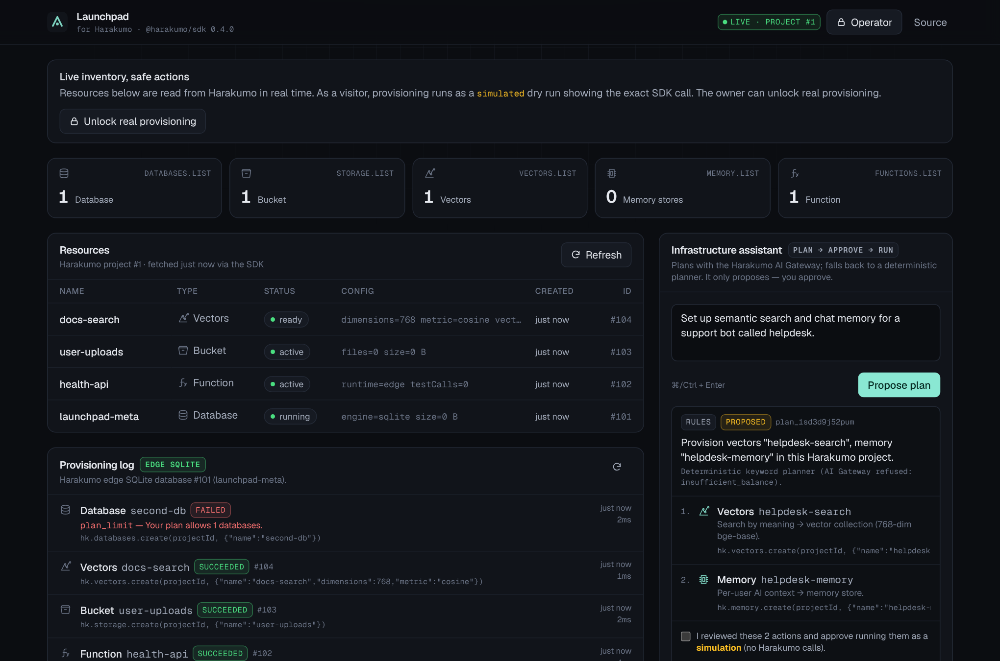

# Harakumo Launchpad

A developer dashboard that **plans and provisions real Harakumo infrastructure** — edge SQLite databases, storage buckets, vector collections, AI memory stores and edge functions — through the official [`@harakumo/sdk`](https://www.npmjs.com/package/@harakumo/sdk) (v0.4.0), with an approval-gated natural-language assistant.

- **Live demo:** https://launchpad-infra.harakumo.app (Harakumo project #85; Hobby apps sleep when idle, first load takes a few seconds)
- **Stack:** Next.js 15 App Router · TypeScript · React 19 · Tailwind CSS 4 · zod · `@harakumo/sdk`
- **Hosted on Harakumo itself** as a Node.js server app (`*.harakumo.app`), so the app dogfoods the platform it manages.



<sub>Screenshot from a local run against the bundled contract stub (`scripts/fake-harakumo.mjs`).</sub>

## What it does

| Area | What's implemented |
|---|---|
| **Infrastructure dashboard** | Live inventory of the project's databases, buckets, vector collections, memory stores and functions (status, type, config, created time, ids). Per-type counters double as filters. Skeleton loading, empty, partial-failure and error states. Auto-polls while anything is provisioning. Detail drawer re-fetches one resource on demand. Responsive table → cards on mobile. |
| **Provisioning** | Form for each supported type with server-side validation. Calls `hk.databases.create`, `hk.storage.create`, `hk.vectors.create`, `hk.memory.create` or `hk.functions.create` and shows Harakumo's returned record. Platform refusals (`plan_limit`, `rate_limited`, `insufficient_balance`, network errors …) are shown with their code and logged. |
| **AI infrastructure assistant** | "Create a database for my application." → structured plan (actions, types, config, the exact SDK call, reasons, notes) → explicit checkbox approval → execution of the *stored* plan. Plans come from the **Harakumo AI Gateway** (`hk.ai.chat`) and every action is re-validated with the same zod schema as the provisioning API; if the gateway is unavailable (e.g. empty AI balance) or returns invalid output, a deterministic keyword planner is used and the UI says which planner ran and why. It is a planner, not an autonomous agent: nothing runs without approval. |
| **Data layer** | App metadata (provisioning log, plans) is stored in a **Harakumo edge SQLite database** in the same project, with ordered, idempotent migrations tracked in `schema_migrations`. Falls back to in-process memory (and says so in the UI) until that database exists. |
| **Safety** | API key is server-only (`import "server-only"`), resource payloads are allow-listed (connection strings / secrets never leave the server), real provisioning requires an operator session, anonymous visitors get clearly labelled **simulated** runs, no delete endpoints exist, per-IP rate limits, same-origin checks, 8 KB body limit. |

## Real vs. demo behaviour

| Feature | Live (API key set) — operator | Live — anonymous visitor | Demo (no API key) |
|---|---|---|---|
| Resource inventory & details | Real (`*.list`, `*.get`) | Real, sanitized | Sample data, labelled `sample` |
| Provision form | **Real** `*.create` | Simulated, shows exact SDK call | Simulated |
| Assistant planning | Harakumo AI Gateway → rules fallback | same | Rules planner |
| Assistant execution | **Real** after approval | Simulated after approval | Simulated |
| Provisioning log | Harakumo edge SQLite | same | Memory |

A simulated operation is always stored and displayed with `status: "simulated"`, never as success.

## Architecture

```
 Browser (React client components)
   │  fetch /api/*  (JSON, same-origin, no secrets)
   ▼
 Next.js App Router route handlers ───────────────┐
   │ zod validation · rate limit · origin check   │
   │ operator session (HMAC cookie / Bearer)      │
   ▼                                              │
 src/lib/resources.ts   src/lib/planner.ts        │ structured JSON logs
   │ list/get/create      │ hk.ai.chat → zod      │ (harakumo logs <deploy>)
   │ allow-list sanitize  │ rules fallback        │
   ▼                      ▼                       │
 src/lib/harakumo.ts  — the only SDK instance (server-only, HARAKUMO_API_KEY)
   │
   ▼  HTTPS, Bearer hk_live_…
 Harakumo platform ── project (HARAKUMO_PROJECT_ID, injected at deploy)
   ├─ edge SQLite  "launchpad-meta"  ← operations + plans (migrations)
   ├─ databases / buckets / vectors / memory / functions  ← provisioned
   └─ AI Gateway (harakumo-1 router)
```

```
src/
  app/
    page.tsx                         # dashboard shell
    api/health/route.ts              # GET  liveness + mode
    api/session/route.ts             # GET/POST/DELETE operator session
    api/resources/route.ts           # GET list · POST provision
    api/resources/[type]/[id]/route.ts  # GET one resource
    api/operations/route.ts          # GET provisioning log
    api/assistant/plan/route.ts      # POST propose plan
    api/assistant/execute/route.ts   # POST run approved plan
  components/                        # client UI (Dashboard, AssistantPanel, ProvisionForm, …)
  lib/
    config.ts      # env → mode (live | demo)
    harakumo.ts    # SDK client + error normalisation (server-only)
    resources.ts   # list / get / provision, sanitizers, function templates
    planner.ts     # AI Gateway planner + deterministic fallback
    store/         # metadata store (edge SQLite | memory) + migrations
    security.ts    # rate limit, origin check, operator session
    schemas.ts     # zod contracts shared by server and client
scripts/
  fake-harakumo.mjs  # offline contract stub of the SDK endpoints used (tests only)
  smoke.sh           # end-to-end API smoke test
```

### Design decisions

- **One project, one key.** The app provisions into its own Harakumo project (`HARAKUMO_PROJECT_ID` is injected by the platform), so a project-scoped key is enough — the narrowest key that works.
- **Stored plans.** `/execute` takes only `{ planId, approve: true }`; the server runs the plan it stored, so the browser cannot alter actions after the user reviewed them. A plan can run once.
- **No user code.** Functions are created only from vetted templates (`health`, `echo`); the model and the user choose a template, never source.
- **Stop on first failure.** Plan execution stops at the first failed action and reports the rest as skipped, avoiding half-configured stacks.
- **Hobby-plan aware.** Hobby allows 1 database, so once `launchpad-meta` exists a second database returns Harakumo's `plan_limit` — surfaced in the UI and log rather than hidden.

## API

All endpoints return JSON. Errors have the shape `{ "error": { "code", "message", "retryable", "issues?" } }`.

| Method | Path | Body | Notes |
|---|---|---|---|
| GET | `/api/health` | — | `{ ok, mode, projectId, sdk }` |
| GET | `/api/session` | — | What this visitor can do (`mode`, `operator`, `canExecute`, `store`) |
| POST | `/api/session` | `{ token }` | Sets an 8 h httpOnly operator cookie. 5/min/IP. |
| DELETE | `/api/session` | — | Sign out |
| GET | `/api/resources` | — | `{ mode, projectId, resources[], errors[] }` — partial failures listed per type |
| POST | `/api/resources` | `{ type, name, config? }` | 201 real · 200 simulated · 4xx validation · 502/429 platform failure (body still contains `operation`) |
| GET | `/api/resources/:type/:id` | — | Fresh status + safe extras (DB limits, function source, vector searchability) |
| GET | `/api/operations?limit=25` | — | Provisioning log, newest first |
| POST | `/api/assistant/plan` | `{ prompt }` | Proposes a plan; never provisions. 8/min/IP |
| POST | `/api/assistant/execute` | `{ planId, approve: true }` | Runs a stored plan once. 4/min/IP |

`type` ∈ `database | bucket | vectors | memory | function`. `name`: 4–40 chars, `[a-z][a-z0-9-]*[a-z0-9]`.
`config`: vectors `{ dimensions: 384|768|1024, metric: cosine|euclidean|dot }`; function `{ runtime: edge|node22, template: health|echo }`.

Scripts can authenticate as operator with `Authorization: Bearer $LAUNCHPAD_OPERATOR_TOKEN`.

### Examples

```bash
curl -s https://<app>.harakumo.app/api/assistant/plan \
  -H 'content-type: application/json' \
  -d '{"prompt":"My recipe app needs photo uploads and a Postgres database"}'
```
```json
{
  "plan": {
    "id": "plan_ypodapsoqdrt",
    "status": "proposed",
    "planner": "rules",
    "plannerDetail": "Deterministic keyword planner (AI Gateway refused: insufficient_balance).",
    "summary": "Provision database \"recipe-db\", bucket \"recipe-files\" in this Harakumo project.",
    "actions": [
      { "id": "act_…", "request": { "type": "database", "name": "recipe-db", "config": {} },
        "reason": "Relational data → Harakumo edge SQLite.",
        "sdkCall": "hk.databases.create(projectId, {\"name\":\"recipe-db\"})" },
      { "id": "act_…", "request": { "type": "bucket", "name": "recipe-files", "config": {} },
        "reason": "File uploads → private storage bucket with signed links.",
        "sdkCall": "hk.storage.create(projectId, {\"name\":\"recipe-files\"})" }
    ],
    "notes": ["Postgres, MySQL, Redis and MongoDB are not available on Harakumo yet; planned edge SQLite instead."]
  }
}
```

```bash
curl -s https://<app>.harakumo.app/api/assistant/execute \
  -H 'content-type: application/json' -H "authorization: Bearer $LAUNCHPAD_OPERATOR_TOKEN" \
  -d '{"planId":"plan_ypodapsoqdrt","approve":true}'
```
```json
{
  "execution": "real",
  "plan": { "id": "plan_ypodapsoqdrt", "status": "failed" },
  "results": [
    { "operation": { "status": "failed", "errorCode": "plan_limit", "sdkCall": "hk.databases.create(…)" },
      "resource": null,
      "error": { "code": "plan_limit", "message": "Your plan allows 1 databases.", "retryable": false } }
  ],
  "skipped": 1
}
```

Failed provisioning is logged as one JSON line, e.g.

```json
{"level":"error","app":"launchpad","event":"provision_failed","opId":"op_cxa4la14w0dl","type":"database","name":"second-db","sdkCall":"hk.databases.create(projectId, {\"name\":\"second-db\"})","ms":184,"err":{"code":"plan_limit","status":402}}
```

## Setup

```bash
npm install
cp env.example.txt .env.local   # fill in HARAKUMO_API_KEY, HARAKUMO_PROJECT_ID, LAUNCHPAD_OPERATOR_TOKEN
npm run dev
```

With no key the app runs in **demo mode** (sample data, simulated actions).

### Environment variables

| Name | Required | Purpose |
|---|---|---|
| `HARAKUMO_API_KEY` | live mode | Workspace key (`hk_live_…`), ideally full access limited to this project. Server-only. |
| `HARAKUMO_PROJECT_ID` | live mode | Injected automatically on Harakumo; set manually elsewhere. |
| `LAUNCHPAD_OPERATOR_TOKEN` | for real provisioning | ≥16 chars. Unlocks real provisioning in the UI / via Bearer. |
| `LAUNCHPAD_DATABASE_ID` / `LAUNCHPAD_DATABASE_NAME` | no | Metadata DB (default: found by name `launchpad-meta`). |
| `LAUNCHPAD_AI_PLANNER` | no | `off` to skip the AI Gateway. |
| `LAUNCHPAD_AI_MODEL` | no | Default `harakumo-1` (router, `fast` tier). |
| `LAUNCHPAD_AI_DAILY_LIMIT` | no | Cap on AI planner calls per server per day (default 60). |
| `LAUNCHPAD_FORCE_DEMO` | no | `1` forces demo mode. |
| `HARAKUMO_URL` | no | SDK base URL override (e.g. the local stub). |

### Offline tests

The repo ships a small contract stub of exactly the endpoints the SDK calls (paths taken from `@harakumo/sdk/universal.js`), with Hobby-style limits, a real SQLite engine (`node:sqlite`) for the metadata DB, and switchable AI behaviour:

```bash
npm run build
node scripts/fake-harakumo.mjs &                       # FAKE_AI=json|error|garbage
HARAKUMO_URL=http://localhost:4010 HARAKUMO_API_KEY=hk_live_fake HARAKUMO_PROJECT_ID=1 \
  LAUNCHPAD_OPERATOR_TOKEN=test-operator-token-123456 npx next start -p 3100 &
./scripts/smoke.sh
```

It covers: AI plan validation (invalid names dropped with a note), visitor → simulated, operator → real, `plan_limit` surfacing, migrations, secret-leak check, invalid operator token.

## Deployment (Harakumo)

1. **Create a project** in the Harakumo dashboard from this GitHub repo (`repoUrl` = this repository, branch `main`). Harakumo detects a Next.js server app and runs `npm run build` then `next start` on Node 22.
2. **Create an API key** — Dashboard → Settings → API access → full key limited to this project.
3. **Set environment variables** on the project: `HARAKUMO_API_KEY`, `LAUNCHPAD_OPERATOR_TOKEN` (CLI: `harakumo env set <projectId> KEY=VALUE`). `HARAKUMO_PROJECT_ID` is injected.
4. **Deploy** (dashboard *Deploy*, or `harakumo deploy <projectId>`). Pushes don't auto-deploy yet.
5. Open the app, unlock operator mode, and provision a database named **`launchpad-meta`** — the log switches to edge SQLite and the migrations run.

Hobby notes: a server app sleeps after 5 idle minutes (first request wakes it in a few seconds); the disk is wiped on sleep/deploy, which is why metadata lives in Harakumo's database.

## Live demo

https://launchpad-infra.harakumo.app — deployed from this repository's `main` branch by Harakumo (Next.js server app, Node 22). Health check: [`/api/health`](https://launchpad-infra.harakumo.app/api/health).

Anonymous visitors see the real inventory (read live through the SDK) and can run the full plan → approve → execute flow as a simulation. The AI Gateway is called on every plan; while the workspace has no AI credit it answers `ai_credits_exhausted` and the UI shows the rules-planner fallback.

## What I would build next

- Status webhooks / SSE instead of polling; `hk.databases.retry` for errored databases.
- Agents: wrap the planner as a Harakumo Agent with `query_vectors` over the docs and function tools, still approval-gated.
- MCP: expose the same plan/approve contract to Claude via the Harakumo AI connector.
- Per-user auth via `hk.auth` instead of a shared operator token; per-user quotas in SQL.
- Unit tests for the planner and sanitizers (vitest) and the smoke test in CI against the stub.
